# Architecture

How data gets from the outside world onto the dashboard, and where the trust boundaries are.
State as of 2026-11-06: `main` at `bd029bb` plus open PR #3 (`claude/media-tracker` at `8c25ee9`). Anything only in PR #3 is drawn with a **thick blue dashed outline**.

The diagrams are Mermaid. Sources are the `.mmd` files in [`architecture/`](architecture/); the SVGs are rendered from them with `docs/architecture/render.sh` (pinned `@mermaid-js/mermaid-cli@11.4.2`). Edit the `.mmd`, re-run the script, commit both.

## Conventions

| Element | Meaning |
|---|---|
| Edge label | `what · format · trigger/cadence · auth` (parts omitted when they don't apply) |
| Solid line | automated |
| Dotted line | manual step, by Jacob or a Claude thread |
| Thick blue dashed outline | exists only in open PR #3 |
| Grey dotted box | planned, not built |
| Red dashed box | trust boundary |
| Cylinder | stored data (a file in git, an API, browser storage) |
| Hexagon | secret |

## Trust boundaries

| Zone | Who can write | Holds secrets? | Calls external APIs? |
|---|---|---|---|
| 1. GitHub Actions runners | workflow files on `main` | **Yes**: `X_BEARER_TOKEN`, plus the job's `GITHUB_TOKEN` (`contents: write`) | **Yes**: PortWatch, straits.live, GDELT, X |
| 2. Claude project workspace | Claude threads, Jacob | No repo secrets | Web research only; output reaches the repo only as a pull request |
| 3. Public repo, `main` | the Actions bot (data commits) or Jacob merging a PR | No | No |
| 4. Public web (Pages + any browser) | nobody; read-only static files | **No** | **No**. The only third-party requests are `` loads of X preview images |

The consequence that matters: **the public site never talks to X.** A GitHub Action calls X once a day with the secret, writes `data/x_posts.csv`, and commits it. The dashboard and the `#monitor` view are the same page reading that same file. X numbers on the site are therefore up to about 24 hours old, and `#monitor`'s 10-minute refresh only picks up a newer commit; it cannot create one.

## 1. Overview

Source: [`01-overview.mmd`](architecture/01-overview.mmd)

## 2. Automated ingest (GitHub Actions)

Source: [`02-automated-ingest.mmd`](architecture/02-automated-ingest.mmd)

| Job | Schedule (UTC) | Reads | Writes | Auth |
|---|---|---|---|---|
| `fetch-portwatch.yml` → `fetch-portwatch.mjs` | `17 6 * * *` daily + manual | PortWatch FeatureServer, else straits.live mirror | `transits_portwatch.csv` (overwrite) | none |
| `fetch-media.yml` step 1 → `fetch-gdelt.mjs` (PR #3) | `41 */6 * * *` + manual | GDELT DOC 2.0 | `coverage_gdelt.csv` (merge by date), `gdelt_articles.csv` (overwrite) | none; ≤1 req / 5 s |
| `fetch-media.yml` step 2 → `fetch-x.mjs` (PR #3) | 06:41 run only, or manual | X API v2 recent search | `x_posts.csv` (merge by id), `x_budget.json` | Bearer `X_BEARER_TOKEN`; 50 posts/run, 1,800/month cap |
| `validate.yml` → `validate.mjs` | every PR + push to `main` | `data/incidents.csv`, `data/incident_sources.csv` | nothing (pass/fail check) | none |

## 3. Curated data (pull requests only)

Source: [`03-curated-data.mmd`](architecture/03-curated-data.mmd)

Incident data is never written by a scheduled job. It is researched in the Claude workspace, regenerated by `_build/build.py`, and lands as a pull request that `validate.mjs` must pass and Jacob must merge. See SPEC §3 for the schema and confidence rules.

## 4. Site runtime (what a browser does)

Source: [`04-site-runtime.mmd`](architecture/04-site-runtime.mmd)

## Known gaps and risks (read from the code on 2026-11-06)

1. **Pages is not enabled yet.** Until Jacob turns it on (Settings → Pages → `main`, root), zone 4 does not exist.
2. **PR #3 still has a temporary trigger.** `fetch-media.yml` runs on every push to `claude/media-tracker` (commented `TEMP ... removed next commit`). Remove it before merge, or each push to that branch spends X budget.
3. **No X data committed yet on PR #3.** `x_posts.csv` and `x_budget.json` are not in the branch at `8c25ee9`, so the X path is drawn from the code, not from a successful run.
4. **The two data jobs are not serialized with each other.** `fetch-media.yml` uses concurrency group `data-commit` and `pull --rebase`; `fetch-portwatch.yml` does neither. They run 24 minutes apart, so a push race is unlikely but possible if one is slow or rerun.
5. **`#monitor` refreshes faster than its data changes.** It refetches every 10 minutes; GDELT data changes every 6 hours, X once a day, and Pages' CDN caches for about 10 minutes.
6. **Viewers' browsers contact X's image CDN** for preview images (`referrerpolicy=no-referrer`, so no page URL is sent, but the viewer's IP is). Everything else is same-origin.
