# Architecture

How data gets from the outside world onto the dashboard, and where the trust boundaries are.
This describes `main` at `0432a3d` (2026-11-06), after the media tracker (#3), cache-busting (#5) and civil-infrastructure (#6) changes merged, plus the free feeds (SPEC 1C): Telegram, news RSS, straits.live events, hourly GDELT.

All diagrams are Mermaid. Their sources are the `.mmd` files in [`architecture/`](architecture/). [`render.sh`](architecture/render.sh) renders them with a pinned Mermaid CLI and the ELK layout, which gives right-angle lines. It then runs [`postprocess.mjs`](architecture/postprocess.mjs), which only moves box titles above the lines. To change a diagram, edit its `.mmd`, run `render.sh`, and commit both files.

## Legend

Edge labels read `what · format · cadence · auth`. Parts that don't apply are left out.

## Trust boundaries

| Zone | Who can write | Secrets? | Calls an API with a key? |
|---|---|---|---|
| 1. GitHub Actions runners | workflow files on `main` | **Yes**: `X_BEARER_TOKEN`, plus the job's `GITHUB_TOKEN` (`contents: write`) | **Yes**: X. It also calls PortWatch, straits.live, GDELT, Telegram previews and news RSS, which need no key |
| 2. Claude workspace | Claude threads, Jacob | No repo secrets | No. Output reaches the repo only as a pull request |
| 3. Public repo, `main` | the Actions bot (data commits), or Jacob merging a PR | No | No |
| 4. Public web (Pages + any browser) | nobody: read-only static files | **No** | **No** |

**How the X and Telegram posts reach the page.** Every 6 hours a GitHub Action runs one X search with the secret key and commits the results to `data/x_posts.csv`. The dashboard and `#monitor` are the same page, and both read that file to decide which posts to show. `#monitor` then loads X's public embed script (`platform.twitter.com/widgets.js`), which draws each post in an iframe so videos play inline. That step uses no key. The site never calls the X API, and the post list is at most about 6 hours old. Telegram works the same way: an hourly Action reads public channel previews into `data/tg_posts.csv`, and `#monitor` shows each post with Telegram's embed script (`telegram.org/js/telegram-widget.js`).

## 1. Overview

## 2. Automated ingest (GitHub Actions)

| Job → script | Schedule (UTC) | Reads | Writes | Auth / limits |
|---|---|---|---|---|
| `fetch-portwatch.yml` → `fetch-portwatch.mjs` | `17 6 * * *` + manual | PortWatch FeatureServer, else the straits.live mirror | `transits_portwatch.csv` (overwrite) | none |
| `fetch-media.yml` → `fetch-x.mjs` | `41 */6 * * *` + manual | X API v2 recent search; next of 15 queries in `x-queries.json` (ships and civil infrastructure, EN/AR/FA) | `x_posts.csv` (merge by post id), `x_budget.json` | Bearer `X_BEARER_TOKEN` · 15 posts per run · stops at 1,800 reads a month · refuses any query without an engagement floor |
| `fetch-free.yml` step 1 → `fetch-telegram.mjs` | `23 * * * *` (hourly) + manual | `t.me/s/<channel>` web previews, 20 channels in `free-feeds.json`, 1–3 pages each | `tg_posts.csv` (merge by post id, 30 days) | none · keeps only posts that pass `match.mjs` |
| `fetch-free.yml` step 2 → `fetch-news.mjs` | same run | Google News RSS (6 queries, 5 languages), 9 outlet RSS feeds, straits.live `events.csv` | `news.csv` (dedup by headline, 7 days) | none · outlet feeds filtered by `match.mjs` |
| `fetch-free.yml` step 3 → `fetch-gdelt.mjs` | same run | GDELT DOC 2.0, `timelinevolraw`, last 7 days | `coverage_gdelt.csv` (merge by date) | none · 1 request, 4 tries; exits quietly on 429 |
| `validate.yml` → `validate.mjs` | every PR + push to `main` | `incidents.csv`, `incident_sources.csv` | nothing (pass/fail check) | none |

## 3. Curated data (pull requests only)

Incidents cover ships and civil infrastructure (ports, oil terminals, refineries, desalination, power, cables, airports), set by the `target` column. No scheduled job writes incident data. Claude threads research it, `_build/build.py` regenerates it, and it arrives as a pull request. The PR has to pass `validate.mjs`, and Jacob has to merge it. SPEC §3 has the schema and the confidence rules.

## 4. Site runtime

Links to x.com and to news articles open in a new tab. They are navigation, not data flow, so they are not drawn.

## Known gaps and risks (read from the code on 2026-11-06)

1. **Third-party scripts on the page.** `#monitor` loads unpinned `platform.twitter.com/widgets.js` and `telegram.org/js/telegram-widget.js` into the page. Whatever X ships runs with full access to the page, and Subresource Integrity can't be used on an unversioned script. Each viewer's IP address and X cookies go to X (`dnt: true` is set). If the script is blocked, each tile falls back to our own link card.
2. **The X budget runs out early in 31-day months.** 4 runs × 15 posts × 31 days = 1,860, which is over the 1,800 cap. The script stops once fewer than 10 reads are left, so the last few runs of a long month skip X.
3. **Not every data job is serialized.** `fetch-media.yml` and `fetch-free.yml` share concurrency group `data-commit` and use `pull --rebase`. `fetch-portwatch.yml` uses neither, so if its push collides with a media push, it fails and that day's PortWatch commit is lost.
4. **`#monitor` refreshes faster than most of its data changes.** It refetches `x_posts.csv`, `tg_posts.csv` and `news.csv` every 10 minutes. X changes every 6 hours, the free feeds hourly, and Pages' CDN caches for about 10 minutes.
5. **Pages has to be enabled.** Zone 4 exists only once Pages is turned on (Settings → Pages → `main`, root). Not checked from here.
6. **Hourly bot commits.** `fetch-free.yml` commits up to 24 times a day, which grows git history and redeploys Pages each time.
7. **Telegram previews are scraped HTML.** If Telegram changes the `t.me/s` markup, `fetch-telegram.mjs` finds no posts; it logs which channels failed and fails the step only if all do.
